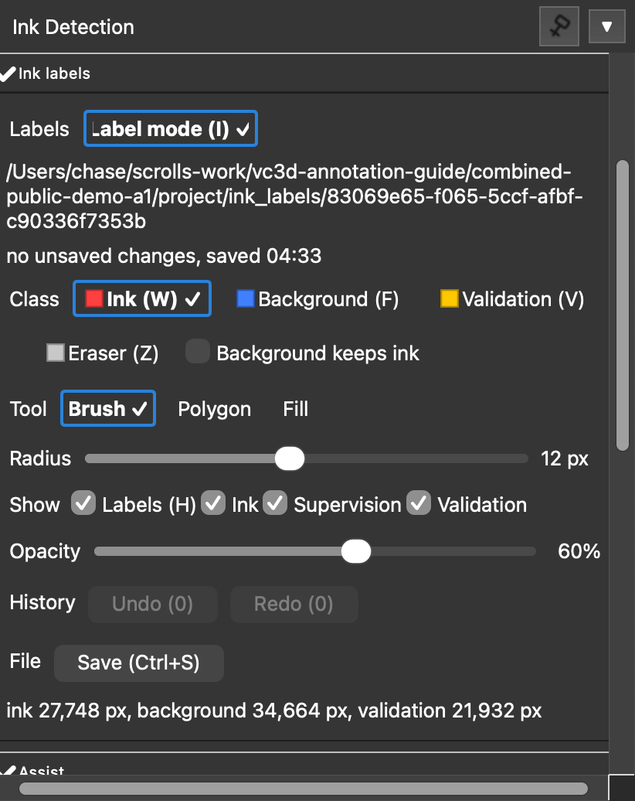
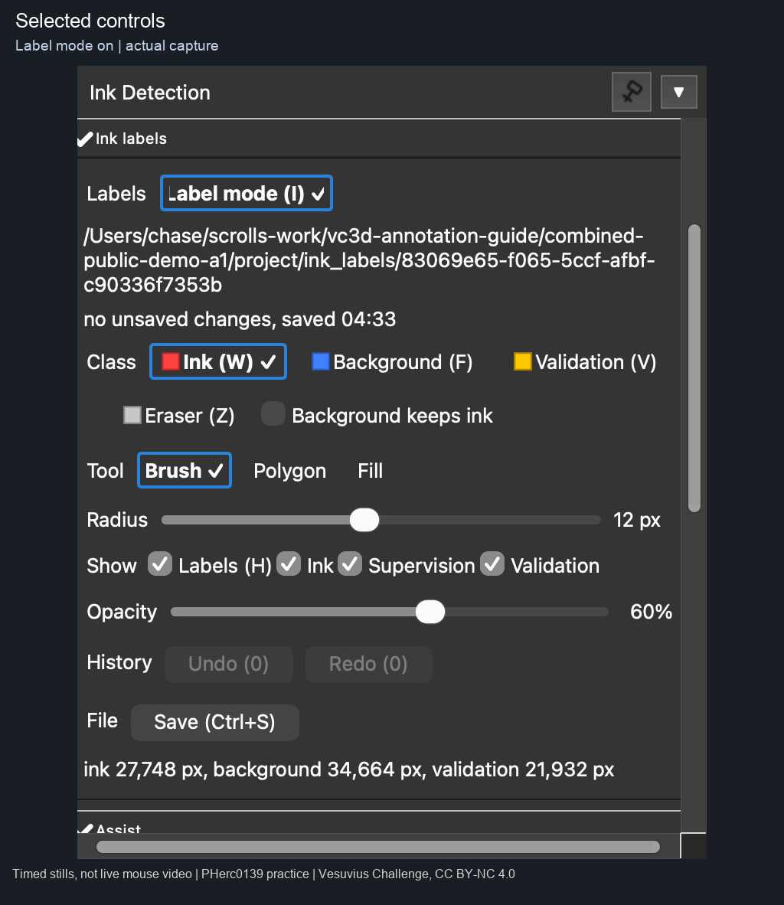
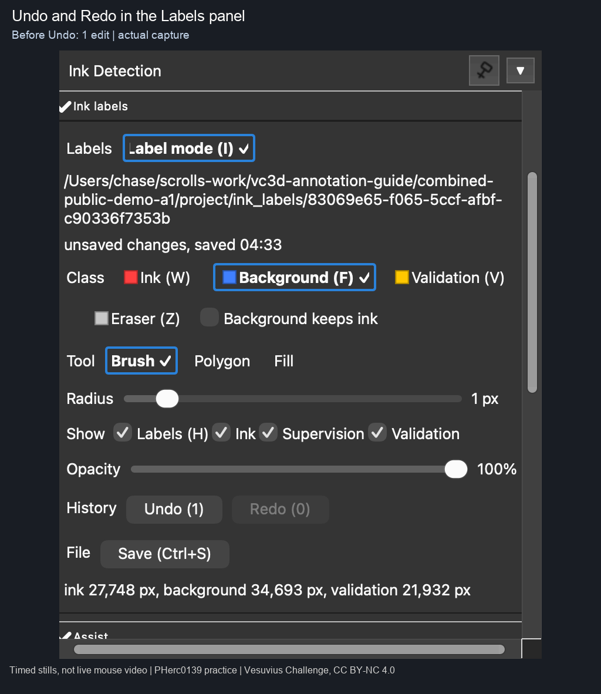
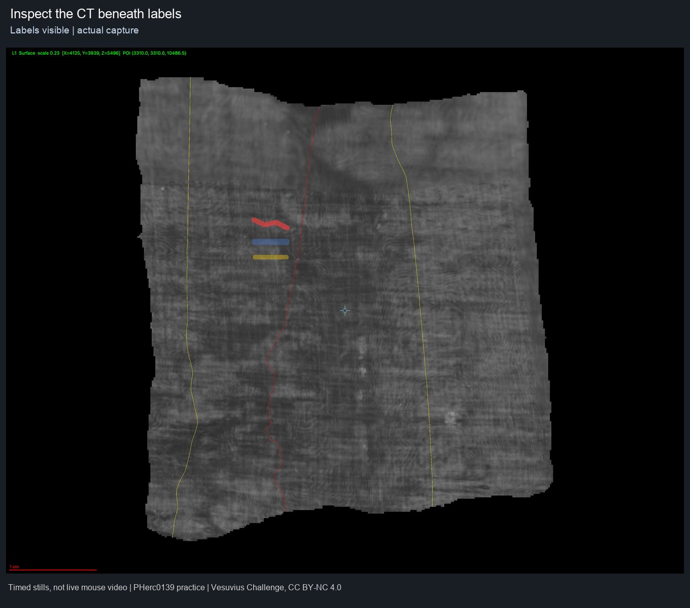
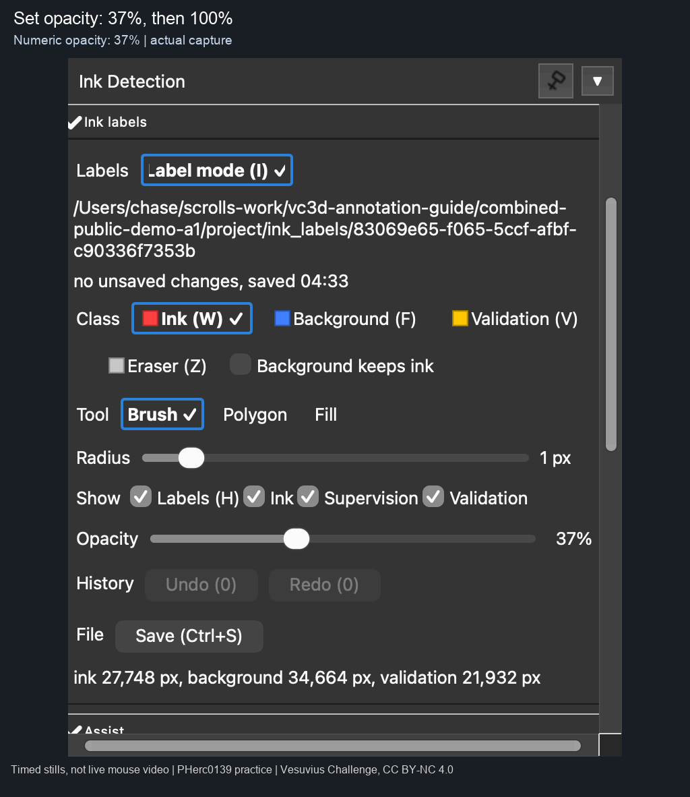
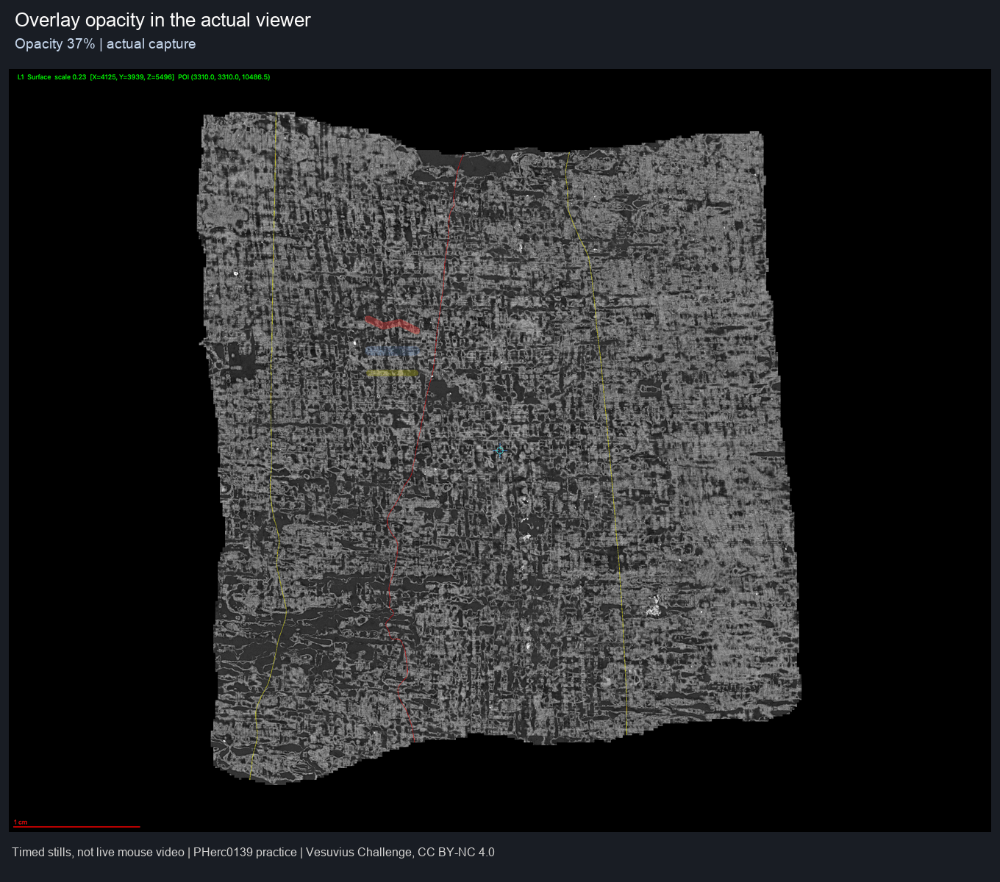
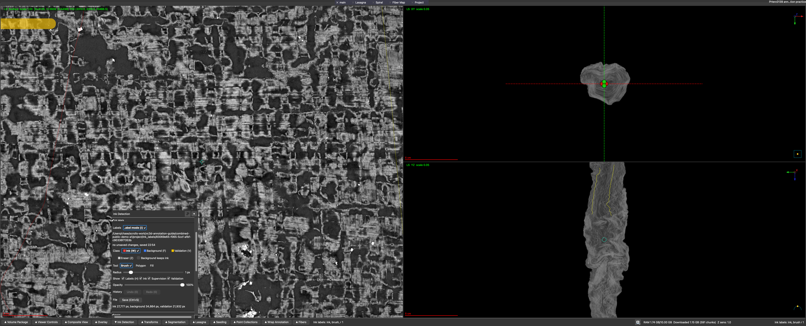

# Paint and inspect ink labels in VC3D

Use a copy of your project for practice. These examples show public PHerc0139 w035 data with disposable annotations.

## 1. Open Labels

Select the segment in the main flattened view and turn segmentation editing off. Open **Ink Detection**, expand **Ink labels**, and enable **Label mode**. If the panel collapses when you return to the viewer, reopen it before changing a control.

## 2. Choose a class and paint

Choose **Ink**, **Background** or **Validation**, then **Brush** and a small **Radius**. A checkmark and outline identify the selected controls.

Unlabeled pixels mean **unknown**. Background marks explicit non-ink supervision. Enable **Background keeps ink** when background painting should preserve existing ink labels.

Left-click or drag on the flattened segment to make a small mark. **Eraser** removes annotation; it does not mark supervised background. Use **Undo** and **Redo** to correct a mark and check the history counts.

If the panel reports read-only or locked labels, resolve that project or segment state before editing.

## 3. Inspect the CT

Toggle **Show Labels** to compare your marks with the CT. The separate Ink, Supervision and Validation checkboxes control their overlays. Thin scene-intersection lines may remain when labels are hidden.

Set **Opacity** to suit the comparison. The percentage beside the slider shows its value. Here it is set to **37%**, then **100%**.

## 4. Save and reopen

Choose **Save**, check for “no unsaved changes,” then reopen the labels and confirm that your marks remain.

The [floating panel](stills/02-labels-floating.png), [Assist](stills/03-assist.png) and [Versions and import](stills/04-versions.png) are also illustrated.

[Validation, capture method, tested scope and data credit](README.md#validation-and-provenance)
